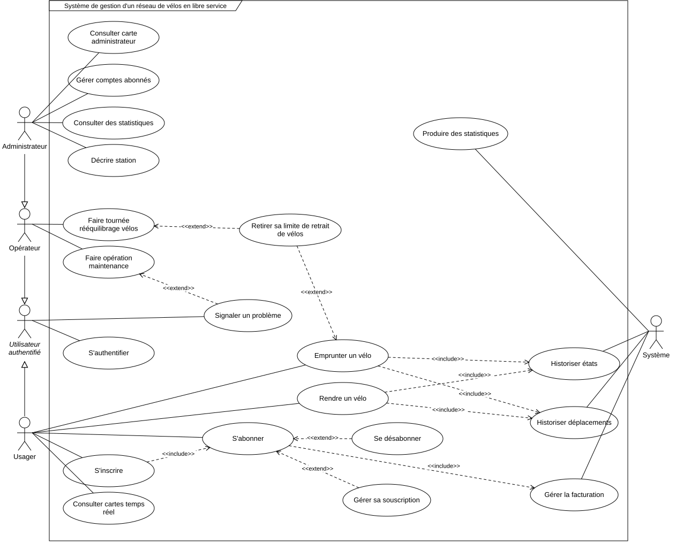
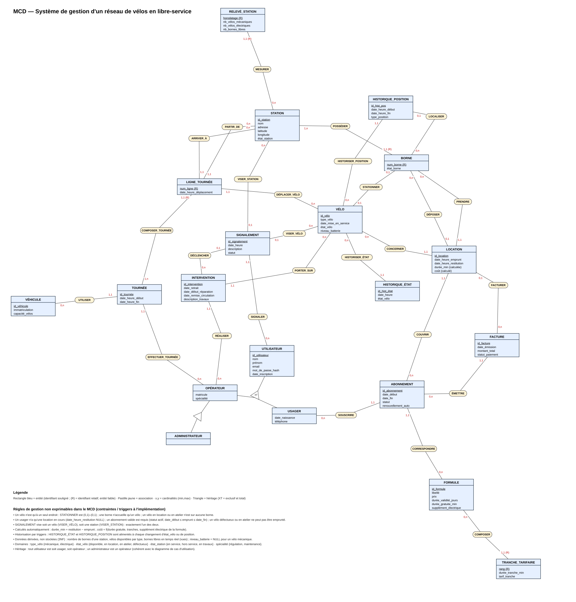
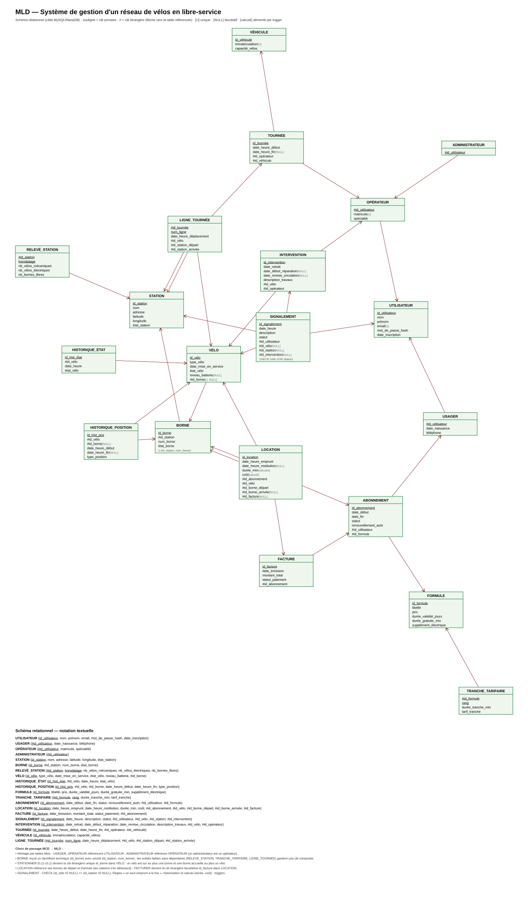

# Vélo libre-service 🚲

Système de gestion d’un réseau de vélos en libre-service réalisé dans le cadre du projet de base de données **BD70** à l’UTBM.

Le projet modélise les stations, les bornes, la flotte de vélos mécaniques et électriques, les usagers, les abonnements, les locations, la maintenance et la régulation du réseau. Une interface PHP permet de consulter les données, d’effectuer des locations et de suivre les principaux indicateurs d’exploitation.

## Fonctionnalités

### Interface web (Slim 4 + Twig + Tailwind CSS)

| Rôle | Pages |
|---|---|
| Visiteur | accueil avec la disponibilité du réseau, inscription, connexion |
| Usager | tableau de bord, stations en temps réel, emprunt et restitution d’un vélo avec coût estimé en direct, historique des trajets, abonnement (souscription, renouvellement, résiliation, factures), signalements, profil |
| Opérateur | tableau de bord d’exploitation, flotte (filtres, fiche vélo avec historiques d’état et de position), toutes les locations (filtres par date, statut, station, type, usager), file des signalements, statistiques avec graphiques et exports CSV, propositions de rééquilibrage |
| Administrateur | droits de l’opérateur, plus la gestion des stations (création, modification, ajout et mise hors service de bornes, suppression) et des comptes (recherche, création d’opérateurs) |

Sécurité : mots de passe hachés avec bcrypt, régénération de la session à la connexion, limitation des tentatives de connexion, jeton CSRF sur chaque formulaire, contrôle d’accès par rôle, requêtes préparées uniquement, échappement automatique de Twig, en-têtes HTTP de sécurité et compte MySQL dédié en moindre privilège.

### Base de données

- modèle relationnel normalisé avec gestion des rôles (`usager`, `operateur`,  `administrateur`)
- contraintes d’intégrité pour garantir qu’un vélo et une borne ne sont pas utilisés à plusieurs endroits simultanément
- historisation des changements d’état et de position des vélos
- procédures stockées pour les abonnements, locations, maintenance, rééquilibrage et statistiques
- triggers pour l’historisation, la validation des locations et la facturation.

Les règles métier restent dans la base : l’application appelle les procédures stockées (`sp_emprunter_velo`, `sp_rendre_velo`, `sp_souscrire_abonnement`, `sp_stat_*`…) et affiche tels quels les messages d’erreur levés par `SIGNAL`.

## Aperçu

### Cas d’utilisation



### Modèle conceptuel



### Modèle logique



## Prérequis

- **MariaDB 10.4+** (testé avec MariaDB 10.4.32 de XAMPP) ou **MySQL 8**, ici sur le port **3307**
- **PHP 8.2 ou supérieur** avec les extensions `pdo_mysql` et `mbstring`
- **Composer**
- une connexion Internet pour les CDN (Tailwind CSS, Chart.js, police Inter).

### Configuration recommandée du serveur

Dans `my.ini` (XAMPP : `C:\xampp\mysql\bin\my.ini`, section `[mysqld]`), puis redémarrer le serveur :

```ini
event_scheduler=ON              # événements planifiés : expiration des abonnements, facturation, relevés
innodb_buffer_pool_size=4G      # XAMPP fournit 16M : la base complète (≈ 5 Go) serait relue sur disque à chaque requête
innodb_log_file_size=512M       # ≈ 25 % du buffer pool
```

Sans `event_scheduler=ON`, les procédures `sp_expirer_abonnements`, `sp_facturer_locations` et `sp_releve_stations` restent appelables à la main mais ne s’exécutent pas automatiquement.

## Installation

### 1. Créer la base de données (compte root)

Exécuter les scripts dans cet ordre :

1. [`database/schema.sql`](database/schema.sql) : base, tables, contraintes et index
2. [`database/triggers.sql`](database/triggers.sql) : automatisation et historisation
3. [`database/procedures.sql`](database/procedures.sql) : vue, procédures métier et statistiques
4. [`database/seed.sql`](database/seed.sql), puis `CALL sp_seed_petit();` (ou `sp_seed_demo()`) : données factices
5. [`database/app_user.sql`](database/app_user.sql) : compte applicatif `velo_app`. **Remplacez d’abord `CHANGER_CE_MOT_DE_PASSE`.**
6. [`database/demo_accounts.sql`](database/demo_accounts.sql) : un compte de démonstration par rôle.

```bash
mysql -h 127.0.0.1 -P 3307 -u root -p --default-character-set=utf8mb4 < database/schema.sql
mysql -h 127.0.0.1 -P 3307 -u root -p --default-character-set=utf8mb4 < database/triggers.sql
mysql -h 127.0.0.1 -P 3307 -u root -p --default-character-set=utf8mb4 < database/procedures.sql
mysql -h 127.0.0.1 -P 3307 -u root -p --default-character-set=utf8mb4 < database/seed.sql
mysql -h 127.0.0.1 -P 3307 -u root -p velo_libre_service -e "CALL sp_seed_petit();"
mysql -h 127.0.0.1 -P 3307 -u root -p < database/app_user.sql
mysql -h 127.0.0.1 -P 3307 -u root -p --default-character-set=utf8mb4 < database/demo_accounts.sql
```

Sous PowerShell, remplacez `< fichier.sql` par `Get-Content fichier.sql -Raw | mysql ...`.

### Mettre à jour une base existante (migrations)

Une base déjà peuplée (plusieurs Go) ne doit pas être recréée : appliquez plutôt, dans l’ordre, les scripts de [`database/migrations/`](database/migrations/). Ils sont ré-exécutables et ne reconstruisent que ce qui a changé. Ré-exécutez ensuite `procedures.sql` (lui-même ré-exécutable) pour mettre à jour les procédures.

```bash
mysql -h 127.0.0.1 -P 3307 -u root -p --default-character-set=utf8mb4 < database/migrations/001_index_couvrants_stats.sql
mysql -h 127.0.0.1 -P 3307 -u root -p --default-character-set=utf8mb4 < database/procedures.sql
```

La migration 001 reconstruit deux index sur `location` et `releve_station` : sur une grosse base, comptez plusieurs minutes. La table reste lisible et modifiable pendant l’opération.

### 2. Configurer l’application

```bash
composer install
cp .env.example .env      # puis renseigner DB_PASS (mot de passe de velo_app)
```

Le fichier `.env` n’est pas versionné. L’application se connecte uniquement avec `velo_app`, jamais avec `root`.

### 3. Lancer l’interface

```bash
composer start            # équivaut à : php -S localhost:8000 -t public
```

Puis ouvrir <http://localhost:8000>. Comptes de démonstration (mot de passe `Demo1234!`) :

| Email | Rôle |
|---|---|
| `admin@velo.local` | administrateur |
| `operateur@velo.local` | opérateur de maintenance |
| `usager@velo.local` | usager (souscrire un abonnement avant d’emprunter) |

Avec Apache, faites pointer le `DocumentRoot` sur `public/` : le fichier `.htaccess` redirige les requêtes vers `index.php`. En production, mettez `APP_ENV=prod` et `APP_DEBUG=false` pour masquer les erreurs et activer les caches.

## Organisation du dépôt

```text
config/
├── settings.php        # Paramètres lus depuis .env
├── container.php       # Conteneur PHP-DI (PDO, Twig)
├── middleware.php      # Erreurs, en-têtes, Twig, session, CSRF, routage
└── routes.php          # Routes groupées par rôle
database/
├── schema.sql          # Schéma relationnel et contraintes
├── triggers.sql        # Triggers d’intégrité et d’historisation
├── procedures.sql      # Vue, procédures métier et statistiques
├── seed.sql            # Génération de données factices
├── app_user.sql        # Compte MySQL applicatif (moindre privilège)
├── demo_accounts.sql   # Comptes de démonstration
└── migrations/         # Mises à jour ré-exécutables d’une base existante
bin/
├── check-db.php        # Diagnostic de la connexion (composer check-db)
└── bench-stats.php     # Banc de mesure des procédures statistiques
docs/                   # Sujet, diagrammes et rapport
public/
└── index.php           # Point d’entrée unique
src/
├── Controller/         # Contrôleurs (un par domaine)
├── Repository/         # Toutes les requêtes SQL et les appels de procédures
├── Database/           # Accès PDO et traduction des erreurs SQL
├── Middleware/         # Session, CSRF, contrôle d’accès, en-têtes
├── Security/           # Authentification et jeton CSRF
├── Support/            # Session, messages flash et cache des statistiques
└── Twig/               # Filtres et fonctions des templates
templates/              # Vues Twig (layout Tailwind, composants, pages)
```

Les requêtes principales se trouvent dans `src/Repository/`, ce qui facilite le rapport de performances. La page *Statistiques* affiche aussi le temps d’exécution de chaque procédure appelée.

La page *Statistiques* est découpée en onglets (seules les procédures de l’onglet affiché sont exécutées), ses tableaux sont paginés et ses résultats sont mis en cache dans `var/cache/app` (1 h pour une période passée, 5 min si elle inclut aujourd’hui, 30 s pour le temps réel ; durées réglables dans `config/settings.php`). Le lien « Recalculer sans le cache » permet de mesurer le temps réel des procédures.

### Mesurer les performances

```bash
php bin/bench-stats.php --repetitions=5 --periodes=7,30,90,365
```

Le script appelle chaque procédure `sp_stat_*` directement (sans le cache de l’application) pour plusieurs longueurs de période et écrit dans `var/bench/` deux fichiers CSV : `procedures.csv` (premier appel, médiane, min, max, nombre de lignes) et `contexte.csv` (version du serveur, taille du buffer pool, volumes des tables). Ces fichiers alimentent les graphiques du rapport.

## Documentation du projet

Le sujet et les livrables graphiques sont disponibles dans [`docs/`](docs/). Les commentaires présents dans les scripts SQL détaillent les choix de modélisation, les contraintes et les index.

## Licence

Ce projet est distribué sous licence [MIT](LICENSE).
